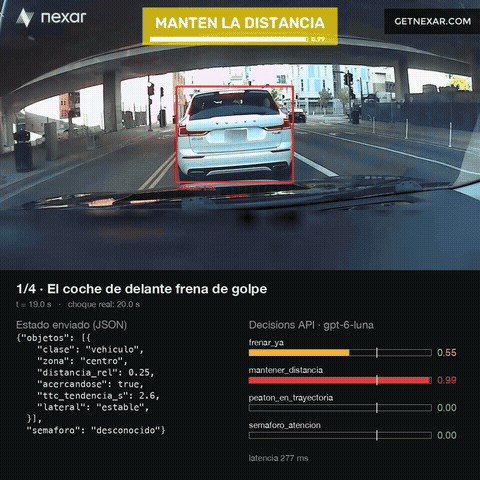

# Copiloto con dashcam · YOLO + OpenAI Decisions API

Un "copiloto" que mira el vídeo de una dashcam en tiempo real, entiende la escena y decide si avisar al conductor: **frenar**, **mantener la distancia**, **peatón en la trayectoria** o **semáforo en ámbar/rojo**.

Lo hice para probar la **Decisions API de OpenAI** (beta, modelo `gpt-6-luna`) en un entorno real, donde las cosas cambian cada segundo.

> ⚠️ Proyecto educativo. **No es un sistema de seguridad** y no debe usarse para tomar decisiones reales al volante.

[](assets/demo.mp4)

▶️ [Vídeo completo (43 s)](assets/demo.mp4) · grabado en directo: cada aviso es la decisión real de la API, con su latencia real.

---

## Idea

**YOLO son los ojos, la Decisions API es el cerebro.** La API no ve el vídeo: recibe un JSON pequeño que resume la escena y responde 4 preguntas tipadas, cada una con su probabilidad.

```
Vídeo (30 FPS)
   │
   ▼
YOLO26s + ByteTrack ─────── detecta y sigue coches, peatones, semáforos (~17 ms/frame en MPS)
   │
   ▼
risk.py ─────────────────── zona (carril), distancia relativa, TTC, movimiento lateral
   │
   ▼
state.py ────────────────── escena → JSON (solo lo relevante, máx. 5 objetos)
   │  (~2 veces por segundo, en un hilo aparte)
   ▼
Decisions API ───────────── 4 predicados con probabilidad (~300 ms)
   │
   ▼
overlay.py ──────────────── cajas por riesgo, aviso, barra de confianza, sonido
```

Ejemplo de lo que se envía y lo que vuelve:

```json
{"objetos": [{"clase": "vehiculo", "zona": "centro", "distancia_rel": 0.19,
              "acercandose": true, "ttc_s": 8.6, "ttc_tendencia_s": 1.5, "lateral": "estable"}],
 "semaforo": null, "historial_decisiones": ["MANTENER_DISTANCIA"]}
```
```
frenar_ya 0.86 · mantener_distancia 0.99 · peaton_en_trayectoria 0.00 · semaforo_atencion 0.00
```

## Sobre la Decisions API

- No genera texto: cada llamada consume ~1.000 tokens de entrada y **0 de salida**. Lee una vez y devuelve una probabilidad por opción.
- Uso **4 preguntas `predicate`** en vez de una `choice`, para que puedan saltar varios avisos a la vez (p. ej. peatón cruzando + semáforo en rojo).
- Las respuestas pueden ser de tipo `refusal` (no aparece en la guía, sí en el SDK).
- Coste aproximado: ~0,6 $ por hora a 2 decisiones por segundo.

## Lo que aprendí

- **El estado importa más que el modelo.** Con "la distancia de hace 1 s" la probabilidad de frenar era 0,15; con el dato ya calculado (`ttc_tendencia_s`), 0,93. Misma escena, mismo modelo.
- **Si preguntas por algo que no está en los datos, puede inventárselo.** Sin poder leer el semáforo, respondía "rojo" con uno en verde. Se arregló con una frase en el contexto.
- **Una falsa alarma también es un problema.** Al principio avisaba al adelantar a cualquier coche. Corrigiendo y midiendo una causa cada vez (cajas cortadas por el borde, TTC fuera de nuestro carril, objetos lejanos, contexto), las falsas alarmas bajaron de **8,9 a 2,8 por minuto**, a cambio de avisar algo más tarde. Evaluado en solo 6 vídeos: orientativo.
- **Depender de una API en tiempo real tiene un coste.** Cuando la beta iba lenta, el copiloto se quedaba sin decisión. Un sistema real necesitaría una regla local de respaldo.
- **Visión monocular:** la distancia es relativa (no metros), cada cámara necesita su calibración y las cuestas la descuadran.

## Puesta en marcha

Probado en macOS con Apple Silicon (PyTorch usa la GPU vía `mps`) y Python 3.13.

```bash
python3 -m venv .venv
source .venv/bin/activate
pip install -r requirements.txt
cp .env.example .env   # y pon tu OPENAI_API_KEY en .env
```

**Vídeos:** se usan clips del [Nexar Collision Prediction Dataset](https://huggingface.co/datasets/nexar-ai/nexar_collision_prediction) (acceso restringido en Hugging Face: hay que pedirlo y aceptar su licencia).

```bash
hf auth login
python scripts/download_videos.py
```

**Ejecutar** (los pesos de YOLO se descargan solos la primera vez):

```bash
python src/capture.py positive/00021
```

Teclas: `d` modo depuración (carril, estelas, probabilidades) · `q` salir. Vídeos con calibración: `positive/00021`, `positive/00015`, `positive/00000`, `negative/01050`, `negative/01074`, `negative/01046`.

## Estructura

```
src/
├── capture.py        bucle principal: vídeo → YOLO → riesgo → estado → API → overlay
├── risk.py           memoria por objeto: zona, distancia, TTC, movimiento lateral
├── state.py          escena → JSON
├── decider.py        Decisions API + hilo de decisiones (errores, timeouts, backoff)
├── traffic_light.py  color del semáforo por HSV
└── overlay.py        dibujo para el conductor + sonido
scripts/
├── download_videos.py  descarga de vídeos de Nexar
├── eval_alerts.py      evaluación de falsas alarmas y choques avisados
├── eval_ttc.py         evaluación del TTC sin API
├── render_demo.py      genera el vídeo de demo (1080×1080)
└── ...                 pruebas de cada fase (GPU, YOLO, modelos, estados, API)
```

`CLAUDE.md` es el plan por fases con el que construí el proyecto paso a paso (con Claude Code como profesor), con las notas de lo aprendido en cada fase.

## Créditos y licencias

- Vídeos: **Nexar Collision Prediction Dataset**, bajo la Nexar Open Data License. Los vídeos no se incluyen en el repositorio, salvo la demo.
- Detección y tracking: [Ultralytics YOLO](https://github.com/ultralytics/ultralytics) (AGPL-3.0).
- Decisiones: [OpenAI Decisions API](https://developers.openai.com/api/docs/guides/decisions) (beta).
